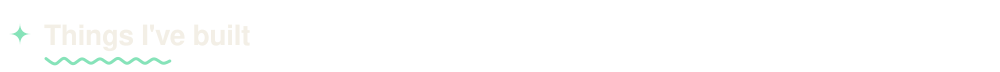
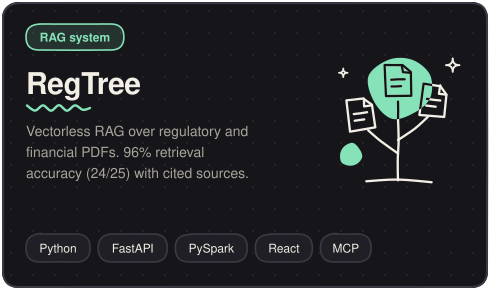
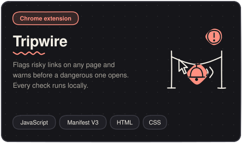
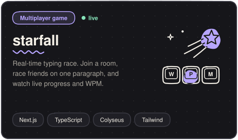
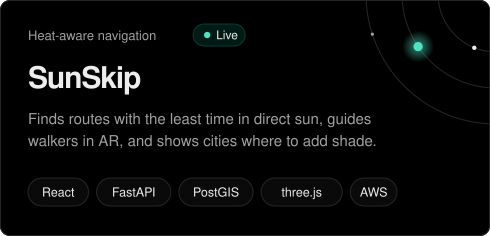
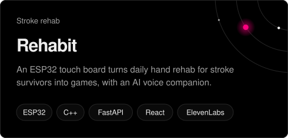
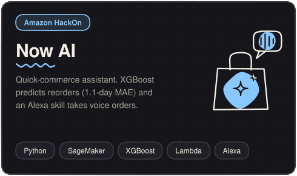

  

I like building with AI and LLMs.

- **At Larsen & Toubro**, as an AI Engineer Intern, I built an AR web app that detects objects with YOLOv11x and overlays live labels using Three.js and WebXR.
- **At Manipal University Jaipur**, I'm a final-year Computer & Communication Engineering student.
- **Along the way:** **SIH 2025 Grand Finalist** among 68,000+ teams, and co-inventor on a published patent.

<table>
  <tr>
    <td width="50%">
      
    </td>
    <td width="50%">
      
    </td>
  </tr>
  <tr>
    <td width="50%">
      
    </td>
    <td width="50%">
      
    </td>
  </tr>
  <tr>
    <td width="50%">
      
    </td>
    <td width="50%">
      
    </td>
  </tr>
</table>

**AI / ML:** LLM application development · Retrieval-augmented generation (vector and vectorless) · Model Context Protocol (MCP) servers · Computer vision (YOLOv11) · Model training and deployment on AWS SageMaker (XGBoost)

**Say hi:** [dhruvhonwad@gmail.com](mailto:dhruvhonwad@gmail.com) · [LinkedIn](https://www.linkedin.com/in/dhruv-honwad)
